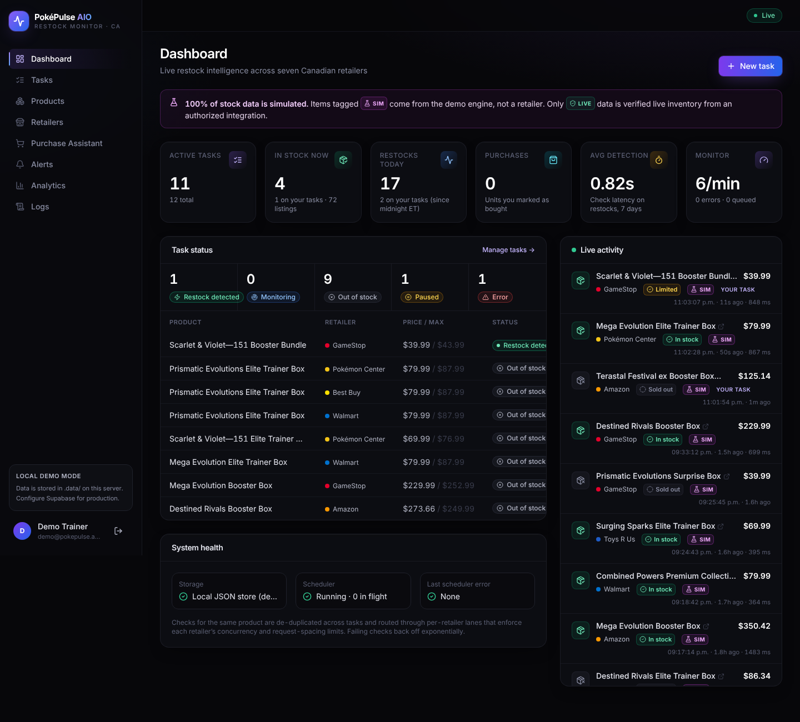

# PokéPulse AIO

A Pokémon TCG restock monitor and shopping assistant for Canadian retailers: Pokémon Center, Walmart, Best Buy, GameStop, Toys R Us, Costco and Amazon (Canada).



**Stack:** Next.js 15 (App Router) · TypeScript · Tailwind CSS · Supabase (Auth + Postgres) · a scheduled monitoring worker · server-sent events · Recharts.

---

## Easiest way to start (no terminal)

1. On GitHub click **Code → Download ZIP**, then unzip it anywhere (e.g. Desktop).
2. Install **Node.js LTS** from https://nodejs.org (one time).
3. Double-click **`Start PokePulse (Windows).bat`** or **`Start PokePulse (Mac).command`**.
   - First run installs and builds automatically (a few minutes), then opens http://localhost:3000.
   - Keep that window open; closing it stops the bot. The Mac launcher also keeps the Mac awake.
   - Mac: if it's blocked as "unidentified developer", right-click it → **Open** → **Open** (only needed once).
4. To update later: download the new ZIP and copy your `.data` folder into it (that's where your account and settings live).

## Quick start (local demo, no setup)

```bash
npm install
npm run build && npm start      # or: npm run dev
```

Open http://localhost:3000 and click **Try the demo account** (`demo@pokepulse.app` / `pokepulse`), or register a new account.

When the Supabase variables are not set, the app runs in **local demo mode**:

- Data is stored in `.data/pokepulse.json`. A 30-day sample catalogue and history are created on first boot.
- Auth is built in: scrypt password hashes and an HMAC-signed, httpOnly session cookie.
- The monitoring scheduler runs inside the Next.js server process.

Set `SIMULATION_INTENSITY=4` for a busier demo with more frequent simulated restocks.

## Production setup (Supabase)

1. Create a Supabase project. Run `supabase/migrations/0001_init.sql` in the SQL editor, or run `supabase db push`.
2. Copy `.env.example` to `.env.local` and fill in `NEXT_PUBLIC_SUPABASE_URL`, `NEXT_PUBLIC_SUPABASE_ANON_KEY`, `SUPABASE_SERVICE_ROLE_KEY` and `SESSION_SECRET`.
3. Run `npm run seed:supabase`. This adds the retailers, the sample catalogue and history, and the demo account.
4. Choose how to run the monitor:
   - **Embedded** (default): `npm start` also runs the scheduler.
   - **Separate worker:** set `WORKER_MODE=external` on the web app, then run `npm run worker` as its own process. The web server sends events to browsers by polling Postgres.
5. Optional: schedule `select public.prune_stock_checks()` daily with pg_cron.

## Pokémon Center inbox watcher (free, no scraping)

Pokémon Center emails subscribers when a drop goes live. PokéPulse can watch **your own inbox** over IMAP and turn those emails into instant Discord / Telegram / browser alerts:

1. Subscribe to Pokémon Center emails and turn on "Notify me" for the products you want.
2. Create an **app password** for your email (Gmail: Google Account → Security → 2-Step Verification → App passwords). Never use your normal password.
3. In PokéPulse → **Alerts → Pokémon Center inbox watcher**: enter your email and app password, click **Test connection**, then switch it on.
4. Set up a Discord webhook and/or Telegram bot on the same page, or keep a PokéPulse tab open for browser alerts.

How it behaves:

- Your inbox is checked every 20 seconds (`EMAIL_WATCH_INTERVAL_SEC`). It's read-only: nothing is marked read, moved or deleted.
- On first connect it only records where your inbox is now. Old emails never trigger alerts.
- Emails from senders on the watch list (default `pokemoncenter.com`) trigger an alert. You can also require keywords.
- If the email names a product you have a Pokémon Center task for, that task flips to **Restock detected** and uses the task's channels and quantity. Otherwise a general "drop" alert is sent with the best link from the email.
- Alerts never go to the email channel, so nothing loops back into the inbox. They're tagged **EMAIL**, not simulated or live.
- **Auto-open** (optional, off by default): when a drop email arrives, the computer running PokéPulse opens the page in your normal browser, the same as clicking the link. Only `https://*.pokemoncenter.com` links are ever opened, at most once per link every 2 minutes. You handle the queue, cart and checkout yourself.
- Use **Test with a sample or pasted email** to check your filters and channels before a real drop.

It runs wherever PokéPulse runs, so your computer has to be on and `npm start` running for it to watch around the clock.

## Simulated vs. live data

This is a hard rule throughout the app. **Every stock data point records where it came from** (`data_source = 'simulated' | 'live'`), and the UI labels it everywhere:

- a **SIM** badge on cards, feed items, tasks and chart events
- a banner showing what share of the data is simulated
- `[SIMULATED]` in the title of every Discord, Telegram and email alert

Only data returned by an authorized integration is labelled **LIVE**.

## Retailer integrations

| Retailer | Status | Notes |
|---|---|---|
| Amazon.ca | **Implemented** (needs credentials) | Product Advertising API 5.0 `GetItems`, signed with AWS SigV4 (`lib/monitor/adapters/amazon-paapi.ts`). Needs an approved Amazon Associates account. Limited to about 1 request per second. Amazon is moving offer data to `OffersV2`; the parser handles both shapes, but check it against the current PA-API docs before you rely on it. |
| Pokémon Center CA | Simulated only | No public inventory API. It has a virtual queue and bot protection, which this app never bypasses. |
| Walmart.ca | Simulated only | No authorized catalogue stock API for walmart.ca. |
| Best Buy CA | Simulated only | The Best Buy developer API covers bestbuy.com (US) only. |
| GameStop / Toys R Us / Costco CA | Simulated only | No public product APIs. |

To add a retailer once you have authorized access (an official API, an affiliate API or a partner feed):

1. Implement `RetailerAdapter` in `lib/monitor/adapters/`.
2. Register it in the `LIVE` map in `lib/monitor/adapters/index.ts`.
3. Update the retailer's entry in `lib/retailers.ts`.

Tasks set to "live" for a retailer with no integration fail on purpose: they show a clear `NOT_AVAILABLE` error instead of quietly scraping.

**Compliance rules:**

- No scraping behind bot protection.
- No CAPTCHA solving.
- No queue skipping.
- No working around purchase limits.
- No storing payment details.
- No automatic checkout.
- The inbox watcher only reads emails Pokémon Center sends you; it never contacts pokemoncenter.com.

The Purchase Assistant gets you to the retailer's own page with your price and quantity already decided. You check out yourself.

## How monitoring works

```
scheduler tick (2s) → due tasks (next_check_at ≤ now)
  → grouped by product + data source   (one upstream request per product, however many tasks watch it)
  → per-retailer lanes                 (max concurrency + minimum request spacing per retailer)
  → adapter.check()                    (simulated or authorized live API)
  → compare with previous state        → restock / sold_out / price_change / check
  → update product + stock_history     (routine checks sampled every 5 min per product)
  → per task: status + alerts          (alert only when a task *enters* "restock detected" within max price)
  → publish events                     → SSE → dashboards, toasts and browser notifications
```

- **Error handling.** Retryable failures (timeouts, 5xx errors, throttling) back off exponentially, up to 30 minutes. After 3 failures in a row the task shows the `error` status. Non-retryable failures (missing credentials, bad URL, no integration) are re-checked every 10 minutes. Every outcome is written to the monitoring log.
- **Rate limits.** Each retailer has a minimum check interval, and task frequencies are clamped to it. Each retailer also has its own concurrency cap and request spacing.
- **Catalogue sweep.** Listings nobody is watching are refreshed slowly (4 every 15 seconds), through the same rate-limited lanes.

## Features

| Page | What it does |
|---|---|
| Dashboard | Active tasks, products in stock, restocks today (Eastern time), purchases, average detection latency, scheduler health, live activity feed |
| Tasks | Create (from the catalogue or a pasted URL), edit, pause/resume, duplicate, delete, check now, bulk actions, history drawer (price chart, stock events, alerts sent, log) |
| Products | Catalogue in 8 categories with search, filters, sorting, favourites, price change since last update, last restock time, 30-day price history |
| Retailers | Integration status, rate limits, listing and stock counts, add a product URL for that retailer |
| Purchase Assistant | Products available within your max price, quantity prep, open the retailer page, checkout-ready alerts (or set one up for when it restocks), purchase log |
| Alerts | Discord webhook, Telegram bot, email (via Resend) and browser notifications; test buttons; quiet hours; full delivery history |
| Analytics | Restocks per day, by retailer, most-restocked products, average time between restocks, availability by retailer, price history. Every chart can switch to a table view. |
| Logs | Filterable monitoring log for all tasks |

## Database

`supabase/migrations/0001_init.sql` creates these tables, with row-level security:

- `profiles` (users and their preferences)
- `retailers`
- `products`
- `favourites`
- `monitoring_tasks`
- `stock_history`
- `notifications`
- `purchase_activity`
- `task_logs`

It also creates indexes for the scheduler's due-task query and a retention function.

## Project layout

```
app/(app)/*            authenticated pages          app/api/*          REST + SSE endpoints
components/            reusable UI (ui.tsx, charts, TaskForm, ActivityFeed, LiveProvider)
lib/store/             Store interface + LocalStore + SupabaseStore
lib/monitor/           scheduler, engine, retailer adapters
lib/notify/            Discord / Telegram / email / browser alert dispatch
lib/services/          task rules, dashboard + analytics aggregation
worker/                standalone worker entrypoint
supabase/migrations/   schema
tests/                 unit tests (npm test)
```

## Scripts

`npm run dev` · `npm run build` · `npm start` · `npm run worker` · `npm run seed:supabase` · `npm run typecheck` · `npm test` (unit) · `npm run test:e2e` (boots a server on port 3100 with throwaway data and drives the bot end to end: sign-up, tasks, restock detection, live alerts, purchase log, error handling, user isolation; run `npm run build` first)

## Limitations

- The local JSON store works with **one process only**. Use Supabase for multiple instances or a separate worker.
- The sample catalogue links to each retailer's search page for the product, not a specific product page. Paste exact product URLs when you create tasks.
- Product images are generated illustrations. Retailer images are not hotlinked; live integrations can supply real ones.
- Browser alerts reach open PokéPulse tabs over SSE. Web Push (alerts with no tab open) is not implemented yet.
